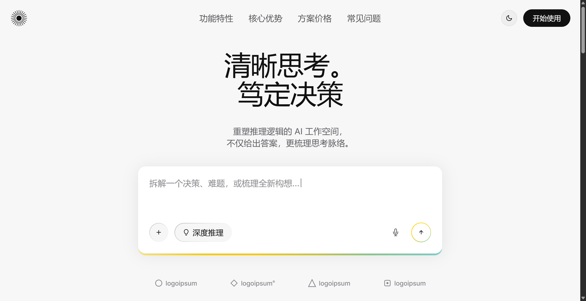
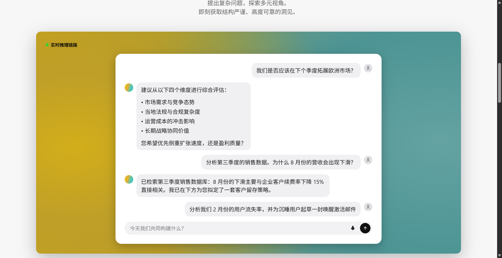
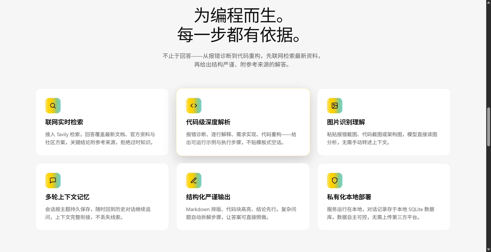
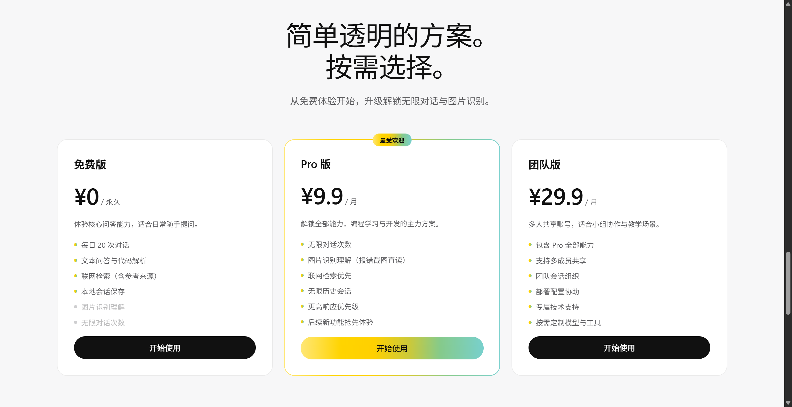
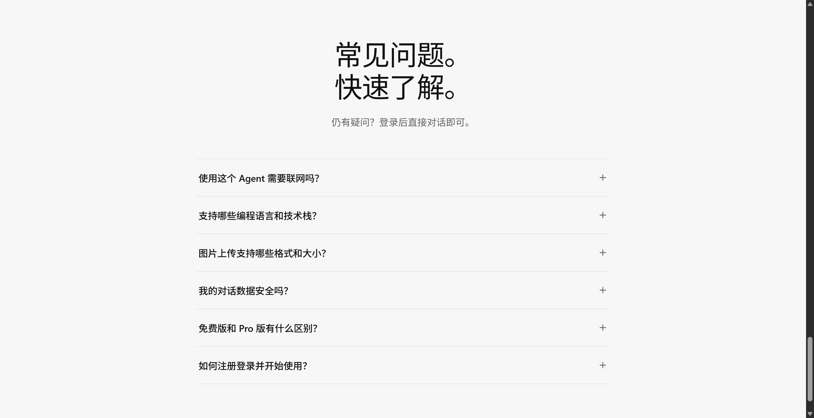
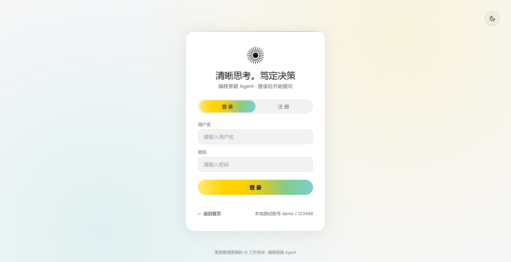
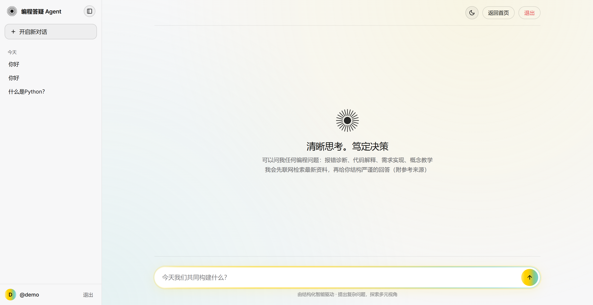
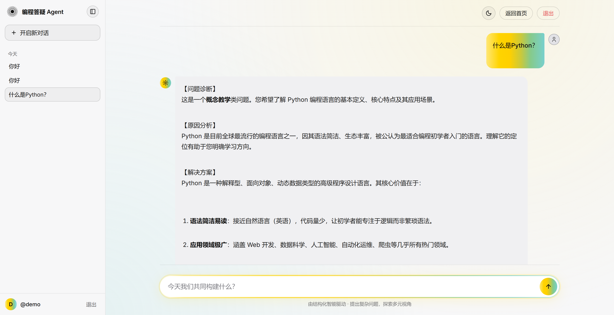
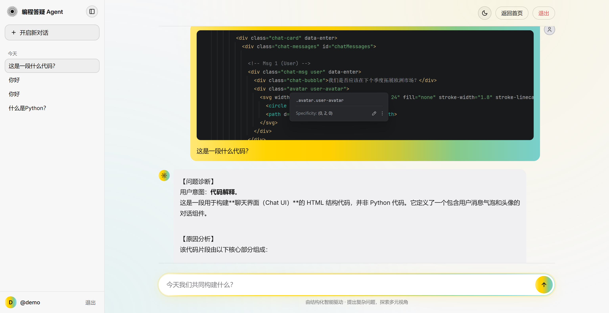

# 《编程答疑 Agent》产品需求文档（PRD）

| 项目 | 内容 |
| --- | --- |
| 文档版本 | v1.0 |
| 编写日期 | 2026-10-23（前端功能同步：2026-10-24） |
| 产品形态 | Web 端 Agent（前端三页：首页展示 / 登录注册 / AI 对话，均已实现） |
| 技术底座 | LangChain + FastAPI + Tavily + Qwen 系列大模型 + 阿里云 OSS |
| 部署环境 | 本地服务器 |

---

## 1. 产品概述

### 1.1 产品定位

**编程答疑 Agent** 是一个面向 Python 自学者的智能编程学习助手。用户上传代码截图、报错截图或用文字描述问题，Agent 通过「视觉识别 → 联网检索 → 智能答疑」给出结构化解答，帮助自学者"遇到问题随手一问、答案可信有来源"。

### 1.2 产品愿景

成为 Python 初学者遇到问题时的第一提问入口：拍个截图就能问，答案带真实参考来源，不再求人、不再被卡住。

### 1.3 核心价值

| 价值点 | 说明 |
| --- | --- |
| 低门槛答疑 | 拍个截图就能问，不用会组织语言描述问题 |
| 权威可信 | 回答附带联网检索的真实参考来源，不凭空编造 |
| 高效定位 | 报错诊断直达原因 + 解决方案 + 示例代码，节省大量搜索时间 |
| 内容沉淀 | 问答记录可沉淀为专栏素材，反哺《逐辉者・VibeCoding》内容生态 |

---

## 2. 目标用户与使用场景

### 2.1 目标用户画像

| 维度 | 描述 |
| --- | --- |
| 核心人群 | Python 初学者：大学生（尤其专科/自学转型）、转行程序员、CSDN 新手读者 |
| 典型特征 | 基础薄弱、遇到报错看不懂、教程看了就忘、没有老师可问 |
| 付费属性 | 对"学习效率工具"有付费意愿，但价格敏感；C 端为主 |
| 场景属性 | 单人使用、碎片化时间学习（刷手机提问）、可能形成学习社群 |

### 2.2 核心使用场景

**场景 A：报错截图求助（最高频）**
> 用户在终端看到 `TypeError: 'NoneType' object is not subscriptable`，完全看不懂，拍照上传截图，输入"这啥意思？"

Agent 行为：识别截图中的报错 → 联网检索该报错的常见原因 → 给出「报错原因 + 解决方案 + 示例代码 + 参考链接」。

**场景 B：代码逻辑看不懂**
> 用户上传一段别人写的爬虫代码截图，问"这段代码在干什么？"

Agent 行为：识别代码 → 逐行/逐块解释 → 给出执行流程说明。

**场景 C：需求不知道怎么写代码**
> 用户说"我想写个脚本，自动把文件夹里的图片重命名"

Agent 行为：解析需求 → 联网检索最佳实践 → 输出实现思路 + 完整示例代码 + 注意事项。

**场景 D：概念理解**
> 用户问"什么是闭包？为什么局部变量在函数里改了外面不变？"

Agent 行为：结合模型知识 + 必要时联网补充，用通俗类比讲清概念，并给出最小示例代码。

---

## 3. 功能需求

### 3.1 功能总览

| 编号 | 功能模块 | 优先级 | 说明 |
| --- | --- | --- | --- |
| F1 | 图片上传 | P0 | 支持代码截图/报错截图上传，走阿里云 OSS |
| F2 | 视觉识别 | P0 | 多模态模型识别图片中的代码、报错文本、界面内容 |
| F3 | 编程答疑 | P0 | 意图识别 + 联网检索 + LLM 结构化回答 |
| F4 | 对话历史 | P1 | 多轮上下文、历史记录持久化、会话管理 |
| F5 | 回答收藏/导出 | P2 | 收藏优秀回答，导出为 Markdown 便于沉淀专栏 |
| F6 | 学习进度统计 | P2 | 记录提问主题、掌握知识点，生成学习报告 |
| F7 | 用户登录/鉴权 | P0 | 注册、登录、Token 鉴权，会话按用户隔离 |
| F8 | 前端页面 | P0 | 首页（展示+登录态 CTA）、登录注册、对话页（侧边栏/流式/图片预览） |

### 3.2 核心功能详述

#### F1 图片上传（阿里云 OSS）

- 用户通过前端上传图片（支持 jpg/png/webp，单张 ≤ 10MB）
- 后端 FastAPI 接口接收图片 → 生成唯一 ObjectKey（如 `user_uploads/{date}/{uuid}.png`）→ 上传 OSS → 返回可访问 URL
- 限制：单次最多 3 张图；对图片做基础校验（格式、大小、是否损坏）
- 安全：OSS 使用私有读写 + 后端签名 URL 供模型读取，防止公开泄露

#### F2 视觉识别

- 调用 Qwen-VL（多模态大模型）理解图片内容
- 识别结果结构化输出：`{"code": "...", "error_text": "...", "language": "python", "confidence": 0.92}`
- 识别失败或置信度过低时，回退为纯文字提问模式，并提示用户补充描述

#### F3 编程答疑（核心闭环）

**流程：**

```
用户输入（图片/文字）
        │
        ▼
┌─────────────────┐      ┌──────────────────┐
│  FastAPI 接口    │ ───▶ │  LangChain Agent  │
│  (接收+校验+OSS) │      │  (意图识别/编排)  │
└─────────────────┘      └──────────────────┘
                                  │
              ┌───────────────────┼───────────────────┐
              ▼                   ▼                   ▼
       ┌────────────┐    ┌──────────────┐    ┌──────────────┐
       │ Tavily 搜索 │    │ 代码/报错解析 │    │ 概念讲解      │
       │ (联网检索)  │    │ (多模态理解)  │    │ (知识+类比)  │
       └────────────┘    └──────────────┘    └──────────────┘
              └───────────────────┬───────────────────┘
                                  ▼
                       ┌────────────────────┐
                       │  LLM 结果整理输出   │
                       │ (结构化+参考来源)   │
                       └────────────────────┘
```

**关键设计点：**

1. **意图路由（LangChain Agent 编排）**：识别用户意图属于「报错诊断」「代码解释」「需求实现」「概念教学」四类之一，走不同处理链路
2. **检索触发策略**：报错诊断、需求实现类问题必须联网检索；概念教学类问题可先凭模型知识回答，必要时补充检索
3. **搜索结果筛选**：对 Tavily 返回结果做质量过滤（优先 Stack Overflow、官方文档、CSDN 优质帖），控制注入上下文条数（Top 3~5）
4. **回答格式**：统一结构化输出

```
【问题诊断】
【原因分析】
【解决方案】
【示例代码】
【参考来源】(真实链接)
【进一步提问建议】
```

5. **引用约束**：回答中涉及的外部信息必须带来源链接；无检索结果时明确标注"基于模型知识回答，建议进一步验证"

#### F4 对话历史

- 会话级上下文（LangChain 记忆），支持多轮追问（如"那如果是字典会怎样？"）
- 历史记录持久化存储，用户可查看过往问答

#### F7 用户登录/鉴权

- 用户注册 + 登录（用户名/密码），登录后发放 Token，接口统一鉴权
- 会话、问答记录、收藏均按用户隔离（`user_id` 关联）
- MVP 阶段仅做账号密码登录，不做第三方 OAuth

### 3.3 前端页面（已实现）

#### F8-1 首页 `index.html`（纯展示，不可输入）

| 区块 | 内容 |
| --- | --- |
| 顶部导航 | Logo、功能特性 / 核心优势 / 方案价格 / 常见问题锚点、主题切换、登录态 CTA |
| Hero | 标题入场动效、"拆解一个决策、难题，或梳理全新构想…"打字机占位 + 控制条（展示用，不可输入） |
| 登录态 CTA | 未登录显示"登录 / 注册"跳 `/login.html`；已登录（`localStorage.agent_token`）变"开始使用"跳 `/chat.html`（含移动端抽屉 CTA） |
| 功能特性 | 渐变面板 + 演示聊天卡片（用户/AI 气泡、引用来源样式、输入条，均为展示） |
| 核心优势 | 6 卡片网格：联网实时检索、代码级深度解析、图片识别理解、多轮上下文记忆、结构化严谨输出、私有化本地部署 |
| 方案价格 | 免费版 ¥0 / Pro ¥9.9·月（渐变描边高亮"最受欢迎"）/ 团队版 ¥29.9·月；已登录时按钮变"开始使用"直达对话页 |
| 常见问题 | 6 条手风琴问答（互斥展开、自动收起） |
| 主题 | 深色 `#0c0c0c` / 浅色 `#f7f7f8`，黄绿渐变 `#ffd400→#78d0cd`，`localStorage.theme` 联动系统 |

**首页截图**

| Hero | 功能特性 |
| --- | --- |
|  |  |

| 核心优势 | 方案价格 | 常见问题 |
| --- | --- | --- |
|  |  |  |

#### F8-2 登录注册页 `login.html`

- 与首页同主题；注册 / 登录双模式切换
- 登录成功写入 `localStorage.agent_token` / `agent_username` 后跳转 `/chat.html`

<p align="center"></p>

#### F8-3 AI 对话页 `chat.html`

| 能力 | 说明 |
| --- | --- |
| 会话侧边栏 | 264px 常驻（桌面），移动端抽屉 + 汉堡按钮 + 遮罩；会话按 今天/昨天/7天内/30天内/更早 分组；"开启新对话"；点击加载历史；悬停 × 删除会话（`DELETE /api/sessions/{id}`） |
| 侧边栏折叠 | 桌面可折叠为 56px 窄条（豆包风格，仅留折叠按钮），状态存 `localStorage.sidebar_collapsed`，窗口跨断点自动恢复 |
| 登录态 | 无 token 自动跳登录页；左下角头像 + `@用户名` + 退出（顶栏亦有退出，双入口） |
| 流式输出 | SSE 逐 token 渲染，Markdown 经 marked + DOMPurify 消毒展示 |
| 图片 | 粘贴 / 上传（OSS，jpg/png/webp ≤10MB），发送前缩略图；点击缩略图或消息内图片全屏 Lightbox 预览（ESC/遮罩/× 关闭） |
| 输入区 | 透明背景 + 顶部细分隔线，输入框主题化底色 + 黄绿渐变描边 + 聚焦光晕 |
| 滚动条 | 消息区与会话列表滚动条隐藏（保留滚动），与豆包/DeepSeek 一致 |
| 顶栏 | 主题切换、返回首页、退出 |

**对话页截图**

| 空状态 | 流式回答 |
| --- | --- |
|  |  |

<p align="center"></p>

### 3.4 非目标（明确不做）

| 项 | 说明 |
| --- | --- |
| 代码执行沙箱 | 不负责运行用户代码，只做分析与答疑 |
| 完整 IDE 能力 | 不做代码补全、调试器、在线编辑 |
| 自动改代码 | 给出示例代码，但不直接修改用户的本地代码 |
| 移动端 App | 首期仅 Web 端，前端形态后续再定 |

---

## 4. 技术架构

### 4.1 架构总览

```
┌─────────────────────────────────────────────────────┐
│                     前端（另行设计）                   │
└──────────────────────┬──────────────────────────────┘
                       │ HTTP
┌──────────────────────▼──────────────────────────────┐
│                  FastAPI 后端                        │
│  ┌───────────────┐  ┌───────────────┐  ┌─────────┐  │
│  │ 登录/注册接口  │  │ 问答流式接口   │  │ 历史接口 │  │
│  │ 上传接口      │  │ 鉴权中间件     │  │         │  │
│  └───────┬───────┘  └───────┬───────┘  └────┬────┘  │
│          │                   │               │       │
│  ┌───────▼───────────────────▼───────────────▼─────┐ │
│  │              LangChain Agent 编排层              │ │
│  │  意图路由 │ 工具调用 │ 上下文记忆 │ 输出解析     │ │
│  └───┬──────────┬──────────┬──────────┬───────────┘ │
└──────┼──────────┼──────────┼──────────┼─────────────┘
       │          │          │          │
┌──────▼───┐ ┌────▼────┐ ┌───▼────┐ ┌───▼──────────┐
│ 多模态 LLM │ │ Tavily  │ │ 阿里云  │ │ 会话记录存储 │
│ (视觉理解) │ │ (联网搜索)│ │  OSS    │ │ (SQLite/DB) │
└──────────┘ └─────────┘ └────────┘ └──────────────┘
```

### 4.2 技术选型说明

| 组件 | 选型 | 选型理由 |
| --- | --- | --- |
| Agent 框架 | LangChain | 生态成熟，支持工具调用、记忆、流式输出；后续可平滑升级 LangGraph |
| 后端 | FastAPI | 异步性能好、类型校验完善、天然适合 AI 服务 |
| 搜索 | Tavily | 专为 LLM 设计，返回结果含内容片段，便于直接注入上下文 |
| 文本模型 | qwen3.8-max（用户指定） | 中文编程语境效果好、成本可控 |
| 视觉识别 | 同 qwen3.8-max（其原生支持图像输入；原 Qwen-VL 方案因账号未开通已弃用） | 与文本同一模型，链路简单稳定 |
| 图片存储 | 阿里云 OSS | 稳定、便宜、与国内生态兼容，私有桶+签名 URL |
| 会话存储 | SQLite | 本地部署轻量够用，无需独立数据库服务 |
| 部署 | 本地服务器 | 用户指定本地部署，资源可控、数据不出本地 |

### 4.3 核心接口定义（实际已实现）

| 接口 | 方法 | 说明 | 关键参数 |
| --- | --- | --- | --- |
| `/api/auth/register` | POST | 用户注册 | `username`、`password`，返回用户信息 |
| `/api/auth/login` | POST | 用户登录 | `username`、`password`，返回 Token |
| `/api/upload` | POST | 上传图片至 OSS（需鉴权） | `file`，返回 `object_key` + 签名 `url` |
| `/api/chat` | POST | 非流式问答（需鉴权，保留） | `message`、`image_urls[]`、`session_id`，返回结构化回答 |
| `/api/chat/stream` | POST | SSE 流式问答（需鉴权） | 同上；事件 `status/token/citation/error/done`，`done` 带 `session_id` |
| `/api/sessions` | GET | 会话列表（需鉴权） | 按用户隔离，含时间分组所需字段 |
| `/api/sessions/{id}` | DELETE | 删除会话（需鉴权） | 双校验归属，连消息一并删除 |
| `/api/sessions/{id}/messages` | GET | 会话消息（需鉴权） | `image_urls` 读取时对 object_key 动态重新签名 |

> 鉴权说明：除注册/登录外，所有接口需在请求头携带 `Authorization: Bearer <token>`，后端中间件统一校验。
> 图片存储说明：上传返回带时效签名 URL 仅用于即时预览；入库存 `object_key`（`user_uploads/{date}/{uuid}.ext`），历史读取时动态重签，避免过期 403。

### 4.4 数据存储设计（草案）

| 表 | 关键字段 | 用途 |
| --- | --- | --- |
| `users` | id、username、password_hash、created_at | 用户账号 |
| `sessions` | id、user_id、created_at、title | 会话（按用户隔离） |
| `messages` | id、session_id、role、content、image_urls、citations | 问答记录（含引用来源） |

---

## 5. MVP 范围与验收标准

### 5.1 MVP（第一版）范围

| 模块 | MVP 必须能力 | MVP 不做 |
| --- | --- | --- |
| 登录 | 注册 + 登录 + Token 鉴权，数据按用户隔离 | 第三方 OAuth、找回密码 |
| 图片上传 | 单张截图上传 + OSS 存储 | 多图、批量 |
| 视觉识别 | 识别报错文本、Python 代码 | 复杂 UI 界面理解 |
| 编程答疑 | 报错诊断 + 代码解释 + 需求实现三类意图，带联网来源 | 概念教学深度调优（放 P1） |
| 对话 | 单会话多轮上下文 | 跨会话记忆、学习报告 |

### 5.2 验收标准（MVP 上线判据）

1. 上传报错截图 → 5 秒内返回带参考来源的结构化诊断，且对常见报错（TypeError/KeyError/IndexError/SyntaxError）诊断准确率 ≥ 80%
2. 全部回答必须带参考来源或明确标注"基于模型知识"
3. 单次问答端到端耗时 ≤ 10 秒（含搜索）
4. API 接口可通过自动化测试（上传、问答、历史三条主链路）

---

## 6. 开发里程碑规划

| 阶段 | 周期 | 内容 | 产出 |
| --- | --- | --- | --- |
| M1 技术验证 | 1 周 | LangChain Agent 骨架、Tavily 接入、多模态识别验证、OSS 上传打通 | 可跑的 Demo 链路（图→答） |
| M2 MVP 开发 | 2 周 | 用户登录鉴权、意图路由、答疑闭环、流式输出、会话历史 | MVP 可体验版本 |
| M3 打磨上线 | 1 周 | 效果调优、错误降级、接口测试、部署 | 正式上线版本 |

**总计约 4 周可上线 MVP。**

---

## 7. 风险与对策

| 风险 | 影响 | 对策 |
| --- | --- | --- |
| 视觉模型对报错截图识别不准 | 核心体验受损 | 识别置信度阈值 + 用户确认回退文字模式；积累标注样本微调提示词 |
| Tavily 中文编程内容质量参差 | 回答可信度下降 | 限定站点白名单（Stack Overflow、官方文档、CSDN）+ 结果重排过滤 |
| LLM 幻觉（编造解决方案） | 用户按错误方案改代码 | 强制引用约束：有检索走检索，无检索明确标注；示例代码提示"需自行验证" |
| 单用户提问成本 | 商业化压力 | 控制检索条数、缓存高频问题、设置调用配额 |

---

## 8. 未来迭代方向（Roadmap）

- **P1**：概念教学链路深度调优、学习报告（知识点掌握热力图）
- **P2**：回答收藏导出（反哺 CSDN 专栏）、错题本模式、AI 出题检测
- **P3**：学习社群分享、知识图谱化
- **商业方向**：答疑服务按月订阅；问答精选沉淀为《逐辉者・VibeCoding》专栏课程素材

---

## 9. 已定案

| 项 | 结论 |
| --- | --- |
| 模型选型 | 文本与视觉识别均使用 qwen3.8-max（原生支持图像输入；Qwen-VL 方案弃用） |
| 登录/用户体系 | 需要登录：注册 + 登录 + Token 鉴权 |
| 部署环境 | 本地服务器 |
| 数据库 | SQLite（本地文件存储，无需独立数据库服务） |
| 前端 | 三页均已实现：`index.html`（展示+CTA）/ `login.html` / `chat.html`（对话） |

---

*文档完。当前进度：全栈 MVP 已落地并通过端到端验证（登录、上传、流式问答、会话管理、历史图片重签、前端各页）。后续可继续输出：接口联调文档、LangGraph 升级方案、效果调优记录。*
